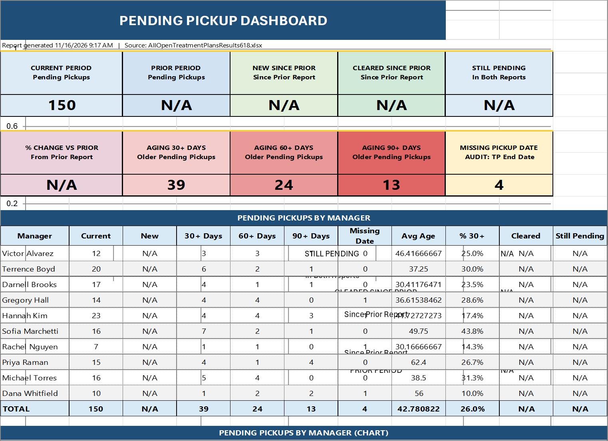

# Pending Pickup Report Builder

Excel VBA tool that converts an **All Open Treatment Plans** export into a monthly **Pending Pickup** report: a KPI dashboard, one tab per Assigned Sales Manager, filtered Raw Data, and optional comparison against the prior month's report.

**Full maintainer guide:** [`documentation/README.md`](documentation/README.md)

## At a glance

| Item | Value |
|---|---|
| Trigger | **CREATE PENDING PICKUP REPORT** button on `START HERE` |
| Output | New `.xlsx` with **Dashboard**, one tab per Assigned Sales Manager, **Raw Data** |
| Work PC package | `Project-Local-Build.zip` (macro-free base + all `.bas` modules + instructions) |
| Macro template zip | `Pending Pickup Template (macro).zip` (`xlsm` only; `.bas` already embedded) |
| Reports | Saved to `Reports/` |
| Logs | `log/` |

## Quick start

1. Open `Pending Pickup Template.xlsm` (enable macros).
2. On **START HERE**, click **CREATE PENDING PICKUP REPORT**.
3. Select the current All Open Treatment Plans export (`.xlsx`/`.xlsm`).
4. (Optional) Select last month's Pending Pickup report for comparison, or **Cancel** to skip.
5. Choose where to save the report (the folder is remembered).

The report opens on **Dashboard** and is saved as `Pending Pickup yyyy-mm-dd_HHMMSS.xlsx`.

## Key artifacts

| File | Purpose |
|---|---|
| `Pending Pickup Template.xlsm` | Macro-enabled master/test template |
| `Pending Pickup Template (no-macros).xlsx` | Macro-free base (regenerated by `sync_template.py`) |
| `Project-Local-Build.zip` | Work-PC rebuild package (no-macro `.xlsx` + all `.bas` + instructions) |
| `Pending Pickup Template (macro).zip` | Macro-enabled `.xlsm` only (`.bas` modules already embedded) |
| `BUILD-INSTRUCTIONS.txt` | Manual rebuild steps (no Python/tools) |
| `vba/*.bas` | VBA source of truth (`modCore`, `modDialog`, `modFormatting`, `modLogging`, `modAudit`, `modDeclarations`, `modUtils`) |
| `scripts/` | Python maintainer tooling |
| `documentation/` | Detailed docs, changelog, screenshots |

## Maintainer workflow

```powershell
# 1. Compile check (after VBA changes)
python scripts\test-compile.py

# 2. Sync modules into .xlsm and rebuild no-macro + both ZIPs
python scripts\sync_template.py

# 3. End-to-end report run (rebuilds artifacts + pushes to GitHub on success)
python scripts\run-report.py
```

On every successful `run-report.py`, both ZIPs are rebuilt and all run artifacts (screenshots, zips, templates) are committed and pushed to GitHub.

## Distribution

- **End users:** receive only `Pending Pickup Template.xlsm` (single self-contained `.xlsm`).
- **Locked-down work PCs:** where downloaded `.xlsm` files are blocked by macro security/Mark-of-the-Web, extract `Project-Local-Build.zip`, import all seven `vba/*.bas` modules into the macro-free `.xlsx`, and save as `.xlsm`. See [`BUILD-INSTRUCTIONS.txt`](BUILD-INSTRUCTIONS.txt).
- Never commit sensitive/PHI data. Generated reports (`Reports/`) and runtime logs (`log/`) are build artifacts and are excluded from version control.

## Screenshots

### Dashboard



### Manager tab (one example)


### Raw Data


> Screenshots are QA captures from test (fake) data. Regenerate with `python scripts\snapshot-report.py`.

---

**Documentation:** [`documentation/README.md`](documentation/README.md) — data contract, comparison logic, output specification, aging definition, known issues, decisions/open questions.

**Maintainer rules:** [`documentation/AGENTS.md`](documentation/AGENTS.md) — changelog conventions, testing loop, file organization, version-control policy.