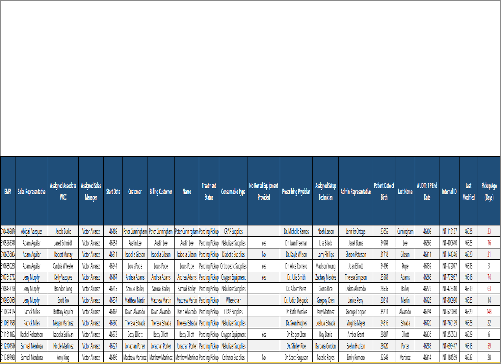
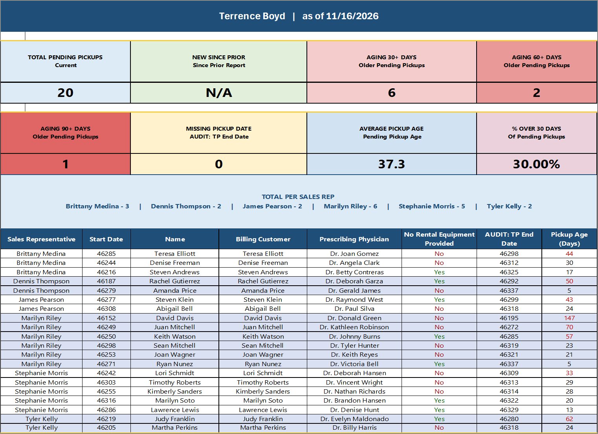
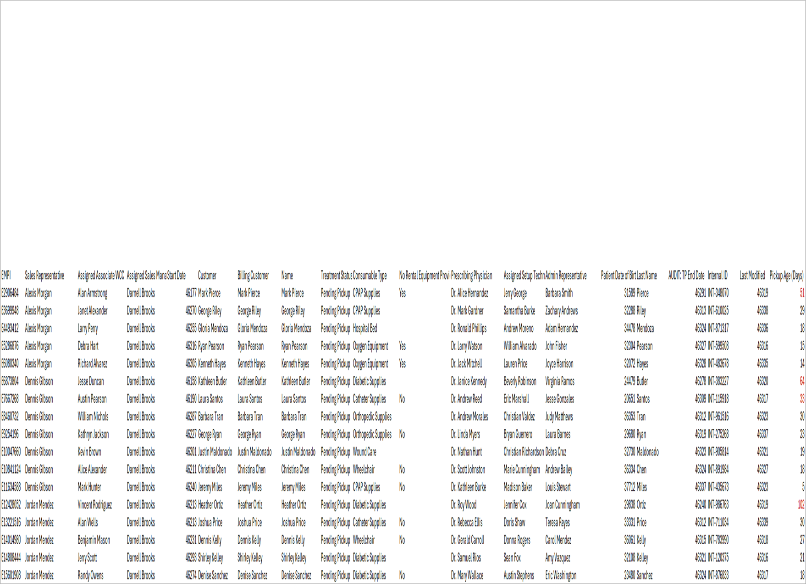
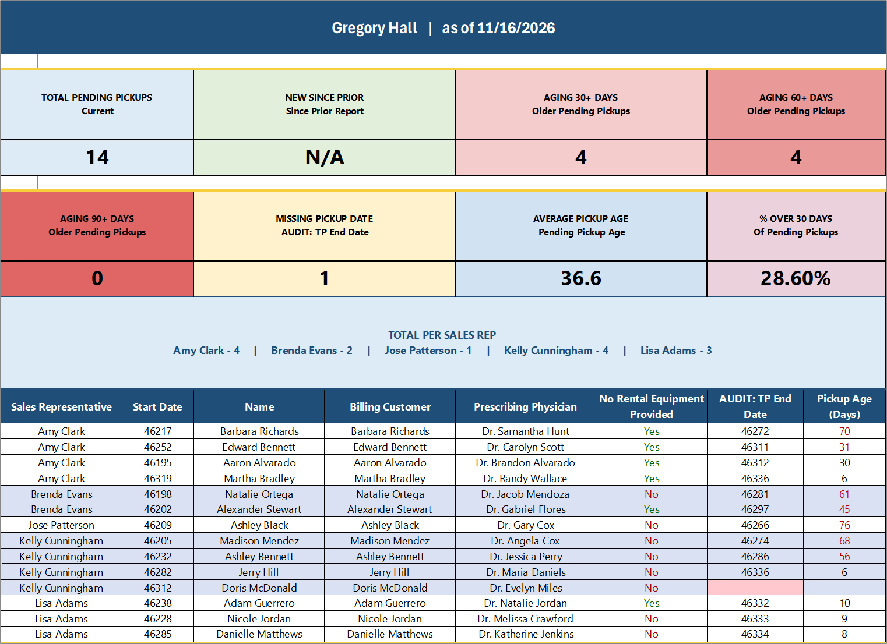
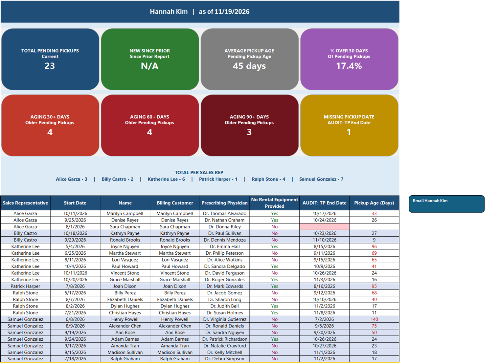
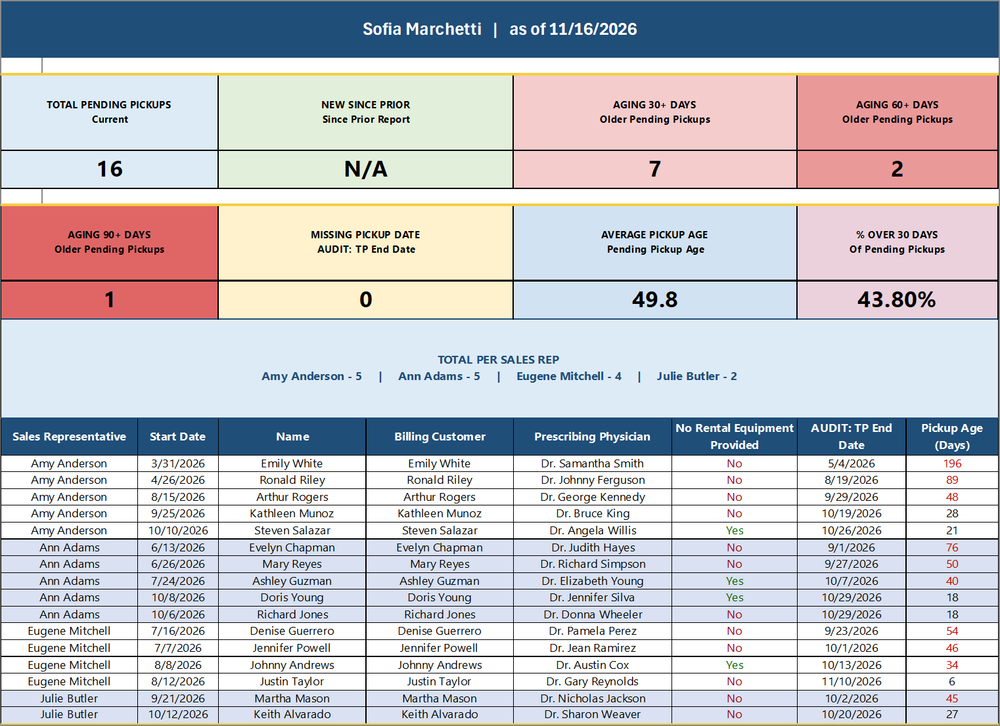
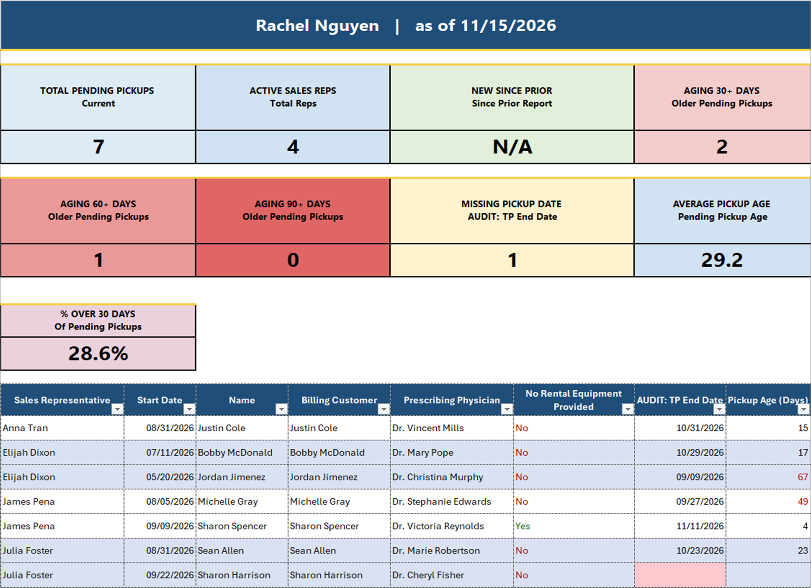
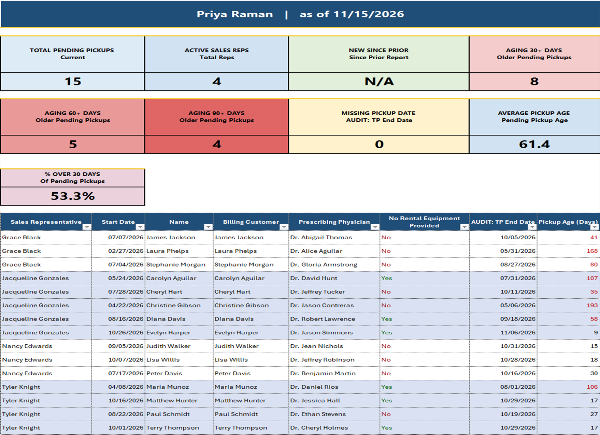
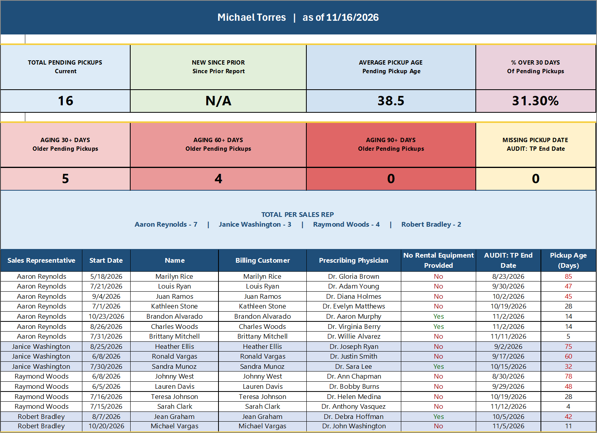
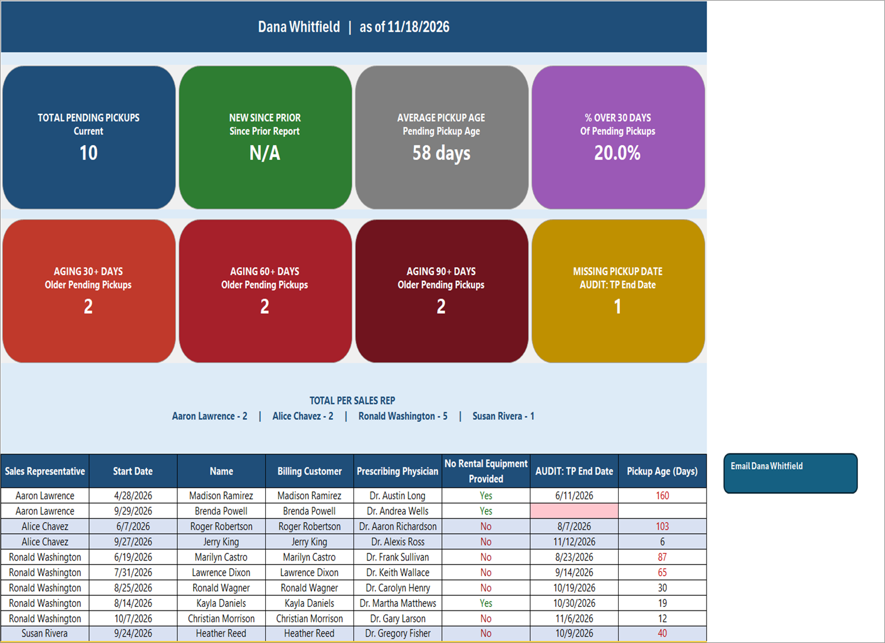

# Pending Pickup Report Builder

An Excel macro-enabled workbook (`.xlsm`) that turns a raw **All Open Treatment Plans** export into a formatted **Pending Pickup** report — a KPI dashboard, one tab per Assigned Sales Manager, and filtered raw data — with optional comparison against the prior month's report.

Every month the report pulls **every patient in the country** from the All Open Treatment Plans export. It references any patient who has equipment pending pickup, and the resulting report is sent to each manager covering their team/region — so each manager sees exactly the patients they need to close out and pick up equipment for.

---

## Quick start

### End users (no setup)

1. **Open `Pending Pickup Template.xlsm`.**
2. **Press `CREATE PENDING PICKUP REPORT`** on `START HERE`.
3. **Select the current All Open Treatment Plans export** when prompted.
4. **(Optional) Select last month's report** for comparison — or **Cancel** to skip.
5. **Choose where to save** the report. The location is remembered via Windows registry and won't be asked again.

### Work-PC / locked-down machines (macro-blocked downloads)

Downloaded `.xlsm` files may be blocked by Windows or organizational macro security (Mark-of-the-Web: “Microsoft has blocked macros…”). Use the **local build package** instead:

1. Download **`Project-Local-Build.zip`** from this repo (GitHub: open the file → **Download raw file**, or use the raw link) and extract to a **local, writable** folder (e.g. `C:\Project\PendingPickup\`).
2. **Unblock** extracted files if needed (right-click → Properties → check **Unblock** → Apply, or `Get-ChildItem | Unblock-File`), per org policy.
3. Open **`Template (No Macros).xlsx`** in desktop Excel.
4. Press **Alt+F11** → **File → Import File…** and import **all** module files (`.bas`): `modAudit.bas`, `modCore.bas`, `modDeclarations.bas`, `modDialog.bas`, `modFormatting.bas`, `modLogging.bas`, `modUtils.bas`. Replace existing modules if prompted. **Do not import only one.**
5. Confirm button(s) are assigned to the correct macro(s): **CREATE PENDING PICKUP REPORT** → `CreatePendingPickupReport`; **Setup Email CC Recipients** → `SetupEmailCC` (if present).
6. **File → Save As** (or Save a Copy) → **Excel Macro-Enabled Workbook (\*.xlsm)** in a local/trusted folder (turn AutoSave off if needed; VBA cannot be saved in `.xlsx`).
7. Close/reopen the `.xlsm`, enable macros if prompted, and run.

See **`BUILD-INSTRUCTIONS.txt`** in the ZIP/repo for the full step-by-step notes.

### Maintainers

After editing VBA source, sync modules into the template (also rebuilds `Template (No Macros).xlsx` and `Project-Local-Build.zip` automatically):

```powershell
python .\scripts\sync_template.py
```

Use `--skip-package` only for rare maintenance cases where you must skip rebuilding the local build package.

To refresh QA screenshots after a successful report run:

```powershell
python .\scripts\snapshot-report.py
```

---

## App workflow

```
1. Open template          → Pending Pickup Template.xlsm
2. Press button           → CREATE PENDING PICKUP REPORT (START HERE)
3. Select raw data        → current All Open Treatment Plans export
4. Optional: prior report → previous month's Pending Pickup report (or Cancel)
5. Select save location   → remembered going forward via registry
```

---

## Repository layout

| Path | Purpose |
|------|---------|
| `Pending Pickup Template.xlsm` | Master workbook users run (embedded VBA + START HERE button + company logo) |
| `Template (No Macros).xlsx` | Macro-free base workbook for local rebuild on locked-down machines |
| `modAudit.bas`, `modCore.bas`, `modDeclarations.bas`, `modDialog.bas`, `modFormatting.bas`, `modLogging.bas`, `modUtils.bas` | VBA source modules (source of truth for rebuild/import) |
| `Pending_Pickup_Macro.bas` | Legacy monolithic VBA export (reference) |
| `BUILD-INSTRUCTIONS.txt` | Step-by-step local rebuild instructions (no Python/tools) |
| `Project-Local-Build.zip` | Downloadable build package: macro-free template + all modules + instructions |
| `scripts\sync_template.py` | Re-import `.bas` modules into the template's embedded VBA |
| `scripts\run-report.py` | Full report run harness (tests end-to-end) |
| `scripts\snapshot-report.py` | Exports report sheets as PNG screenshots for README |
| `Reports/` | Generated report output (build artifacts, not committed) |
| `log/` | Runtime logs (macro-debug.log, etc.) — runtime artifact, not committed |
| `documentation/` | All Markdown documentation and QA screenshots |
| `.kilo/` | Kilo agent/command configuration |

---

## Output specification

Each generated `.xlsx` contains three areas:

### Dashboard

KPI cards, manager breakdown table, and aging breakdown — all styled with Segoe UI font and gold accents matching the START HERE design language.

### Dashboard KPI cards

| Card | Meaning |
|------|---------|
| **CURRENT PERIOD** | Pending Pickups in current report |
| **PRIOR PERIOD** | Pending Pickups in prior report (N/A without prior) |
| **NEW SINCE PRIOR** | Records new since prior report |
| **CLEARED SINCE PRIOR** | Records cleared since prior report |
| **STILL PENDING** | Records in both current and prior |
| **% CHANGE VS PRIOR** | Percentage change from prior period |
| **AGING 30+ DAYS** | Pending pickups older than 30 days |
| **AGING 60+ DAYS** | Pending pickups older than 60 days |
| **AGING 90+ DAYS** | Pending pickups older than 90 days |
| **MISSING PICKUP DATE** | Records missing `AUDIT: TP End Date` |

### Manager tabs

One tab per Assigned Sales Manager with KPI cards, rep-banded data table, freeze panes at the header row, and calculated Pickup Age.

### Raw Data tab

Filtered pending rows only, original column order, filterable table with frozen header.

---

## Screenshots

QA screenshots captured from a live report run (using the bundled fake export data). These show the actual report output with real data, formatting, and styling.

### Dashboard


### Manager tabs

Each Assigned Sales Manager gets its own tab with KPI cards, a rep-banded data table, freeze panes at the header row, and calculated Pickup Age.












### Raw Data

Filtered pending rows with frozen header and date formats.


> Screenshots are QA captures from test/fake data, not live production records. Regenerate anytime against a real report run:
> ```powershell
> python .\scripts\snapshot-report.py -Path "Reports\Pending Pickup yyyy-mm-dd.xlsx"
> ```

---

## Comparison logic

- A row is "pending" when `Treatment Status` contains `Pending Pickup` (case-insensitive).
- Comparison key = `EMPI` (trimmed, case-insensitive); falls back to `Name` when `EMPI` is blank; synthetic `ROW-<n>` if both blank.
- **Still Pending** = key in both current and prior.
- **New** = key in current but not prior.
- **Cleared** = key in prior but not current (equipment picked up and patient closed out, OR patient returned to active).

---

## Aging definition

- **Pickup Age (Days)** = today − `AUDIT: TP End Date` (floored at 0 for future dates).
- **30+/60+/90+** buckets count rows with age **strictly greater than** 30 / 60 / 90 days.
- **Missing Date** counts pending rows with no parseable `AUDIT: TP End Date`.

---

## Requirements

- Windows + desktop Excel (uses `Application.FileDialog`, `SaveSetting`).
- Template saved as `.xlsm` — macros must be enabled.
- "Trust access to the VBA project object model" enabled for `sync_template.py` (`HKCU\Software\Microsoft\Office\16.0\Excel\Security\AccessVBOM = 1`).

---

## Distribution

End users receive only `Pending Pickup Template.xlsm`. It is self-contained (macro, button, company logo embedded).

For locked-down work machines where downloaded `.xlsm` files are blocked by macro security/Mark-of-the-Web, use **`Project-Local-Build.zip`** (`Template (No Macros).xlsx` + all VBA module files + `BUILD-INSTRUCTIONS.txt`) to rebuild a local `.xlsm` without Python or extra tools. You may also share a prebuilt `.xlsm`, but it can still be blocked when downloaded; the macro-free base + modules ZIP is the reliable fallback.

The monolithic export, PowerShell scripts, documentation, screenshots, and fake data are maintainer-only (except where explicitly included in the build ZIP for local rebuild). Keep the ZIP and module files updated whenever the template/VBA changes. Run from a local writable folder if the tool writes outputs/logs next to the workbook, and follow org macro/Trusted Location policy. Do not include sensitive/PHI data in the repo.

---

## Full documentation

Detailed user guide, data contract, known issues, changelog, and agent rules live under `documentation/`:

- [`documentation/README.md`](documentation/README.md) — complete user guide, output spec, known issues, decisions
- [`documentation/changelog.md`](documentation/changelog.md) — dated change log (newest to oldest)
- [`documentation/AGENTS.md`](documentation/AGENTS.md) — agent operating rules
