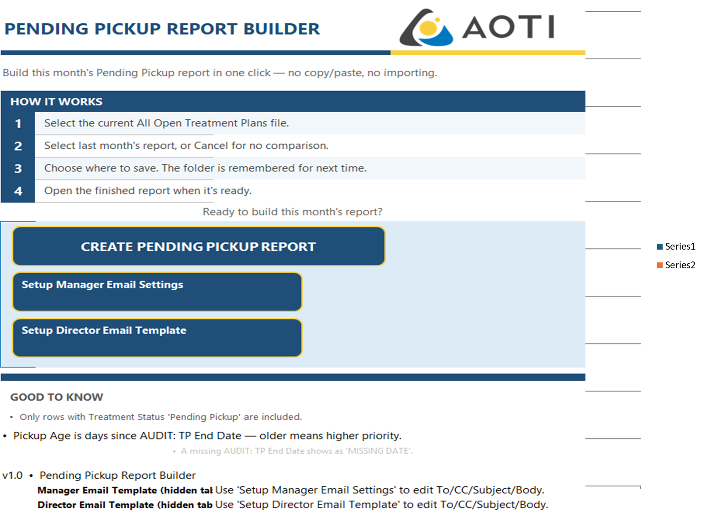
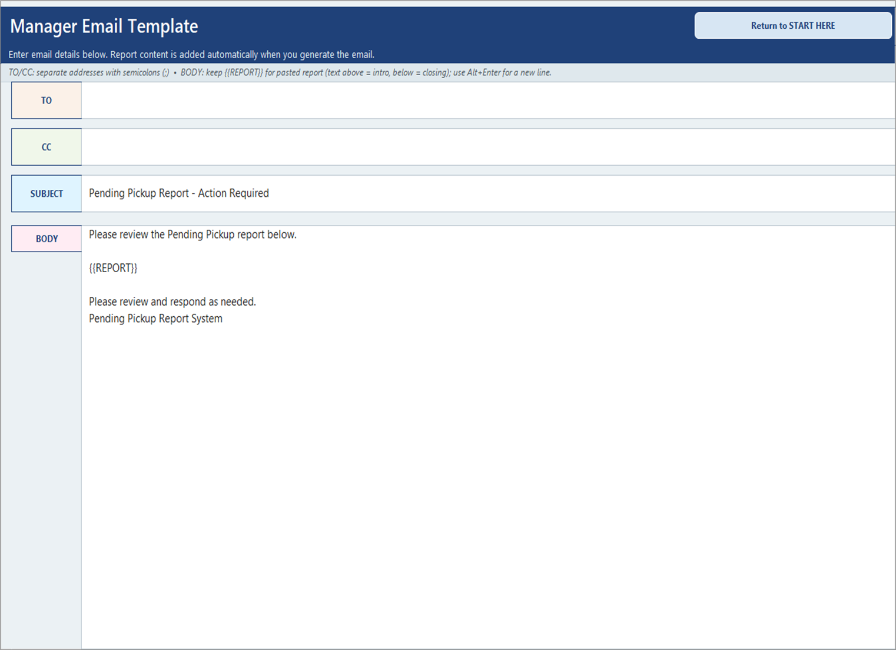
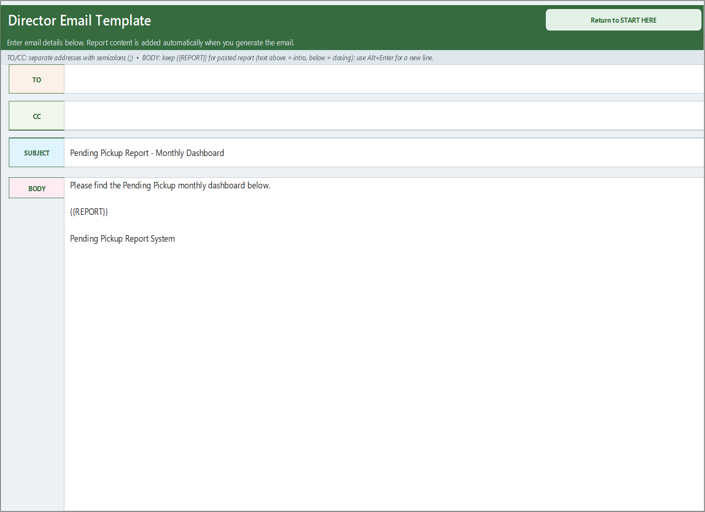
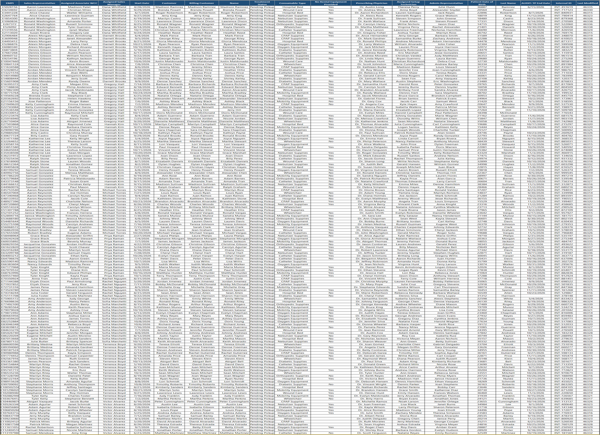

# Pending Pickup Report Builder

Excel VBA tool that converts an **All Open Treatment Plans** export into a monthly **Pending Pickup** report: a Dashboard, one tab per Assigned Sales Manager, filtered Raw Data, and optional comparison against the prior month's report.

- **Macro-enabled (test/dev):** `Pending Pickup Template.xlsm`
- **No-macro base (work PC / locked-down rebuild):** `Pending Pickup Template (no-macros).xlsx`
- **Work PC package:** `Project-Local-Build.zip` (no-macro base + all `.bas` modules + `BUILD-INSTRUCTIONS.txt`)

> Use `Pending Pickup Template.xlsm` for testing on this PC and `Pending Pickup Template (no-macros).xlsx` / `Project-Local-Build.zip` for live/work-PC use. Keep them aligned (see [Keeping templates aligned](#keeping-templates-aligned)).

---

## Quick start

### Generate a report (macro-enabled template)

1. Open `Pending Pickup Template.xlsm`.
2. On **START HERE**, click **CREATE PENDING PICKUP REPORT**.
3. Select the current All Open Treatment Plans export (`.xlsx`/`.xlsm`).
4. (Optional) Select last month's Pending Pickup report for comparison, or **Cancel** to skip.
5. Choose where to save the report (the folder is remembered).

The report opens on **Dashboard** and is saved as `Pending Pickup yyyy-mm-dd*.xlsx`.

### Locked-down work PCs (macro-blocked downloads)

If a downloaded `.xlsm` is blocked by Windows/org policy (Mark-of-the-Web), rebuild locally from the package:

1. Download and extract `Project-Local-Build.zip` to a **local, writable** folder.
2. Unblock extracted files if required (Properties -> **Unblock**), per org policy.
3. Open `Pending Pickup Template (no-macros).xlsx` in desktop Excel.
4. **Alt+F11 -> File -> Import File...** and import **all** `.bas` modules (`modAudit`, `modCore`, `modDeclarations`, `modDialog`, `modFormatting`, `modLogging`, `modUtils`). Replace if prompted.
5. Verify button assignments if needed: **CREATE PENDING PICKUP REPORT** -> `CreatePendingPickupReport`; manager/director email setup buttons -> `SetupEmailCC` / `SetupDirectorEmail`.
6. **Save As -> Excel Macro-Enabled Workbook (*.xlsm)** in a local/trusted folder (AutoSave off if needed).
7. Reopen, enable macros, and run.

See [`BUILD-INSTRUCTIONS.txt`](BUILD-INSTRUCTIONS.txt) for full steps.

---

## Email templates (START HERE)

START HERE includes setup buttons for **Manager** and **Director** emails. Each opens a hidden, formatted template tab with a **Return to START HERE** button.

| Field | Manager tab | Director tab |
|---|---|---|
| To | `D5` | `D5` |
| CC | `D7` | `D7` |
| Subject | `D9` | `D9` |
| Body | `D11` (merged) | `D11` (merged) |

- **TO/CC:** separate multiple addresses with semicolons (`;`).
- **Body marker:** keep `{{REPORT}}` where the copied Excel report should be pasted. Text above = intro, text below = closing. If `{{REPORT}}` is removed, the report is pasted after the body and a default closing is appended.
- **New lines in Excel cells:** use **Alt+Enter**.
- **Director subject:** defaults to monthly dashboard; when sending, the current date is appended if not already present.
- Config is read from the hidden template tabs (`modDialog.bas` / `modDeclarations.bas`) with legacy START HERE fallbacks retained.

---

## Report output

Generated workbook includes:

- **Dashboard** (default sheet): KPI cards, manager breakdown, and pending-pickups-by-manager chart/table.
- **Manager tabs** (one per Assigned Sales Manager): KPI summary, per-rep details, pickup age, and email action.
- **Raw Data**: filtered pending rows in original column order (filterable/frozen header).
- **Audit Log**: run/comparison and data-quality events.

**Comparison logic (when prior report provided):** pending = `Treatment Status` contains `Pending Pickup` (case-insensitive); key = `EMPI` (or `Name` fallback). **Still Pending** = in both, **New** = current only, **Cleared** = prior only. **Pickup Age** = today minus `AUDIT: TP End Date` (30+/60+/90+ are strictly greater than threshold; missing/invalid dates flagged).

---

## Keeping templates aligned

`Pending Pickup Template.xlsm` is the editable/test template; `Pending Pickup Template (no-macros).xlsx` and `Project-Local-Build.zip` must stay in sync for live/work-PC use.

| Command | What it does |
|---|---|
| `python .\scripts\sync_template.py` | Syncs VBA modules/buttons and provisions template/layout/config into `.xlsm`, then rebuilds `.xlsx` (no-macro) and `Project-Local-Build.zip`. |
| `python .\scripts\run-report.py` | Before running, checks email template fields (TO `D5`, CC `D7`, SUBJECT `D9`, BODY `D11`) in `.xlsm` vs no-macro and runs `sync_template.py` automatically if different, then runs the report. |
| `python .\scripts\watch-template-sync.py` | Optional: watches for stable saves to `.xlsm` and auto-runs sync when email/template fields differ (logs to `log/template-watch.log`). Use `--always-sync-on-change` to sync on any saved template change. |
| `python .\scripts\test-compile.py` | Compiles VBA in the template (run after VBA changes). |
| `python .\scripts\snapshot-report.py` | Exports report/template screenshots for documentation. |

**Recommended workflow:** edit VBA/template in `.xlsm` -> `test-compile.py` (if VBA changed) -> `sync_template.py` -> commit/push updated `.xlsm`, `.xlsx`, `Project-Local-Build.zip`, and docs. If you edit email/template content in `.xlsm`, run `run-report.py` or `watch-template-sync.py`/`sync_template.py` so the no-macro/ZIP artifacts pick up the changes.

---

## Repository layout

| Path | Purpose |
|---|---|
| `Pending Pickup Template.xlsm` | Macro-enabled master/test template |
| `Pending Pickup Template (no-macros).xlsx` | Macro-free base (regenerated by sync) |
| `Project-Local-Build.zip` | Work-PC rebuild package (regenerated by sync) |
| `BUILD-INSTRUCTIONS.txt` | Manual rebuild instructions (no Python) |
| `mod*.bas`, `Pending_Pickup_Macro.bas` | VBA modules / legacy export |
| `scripts/` | Python tooling (`sync_template.py`, `run-report.py`, `test-compile.py`, `snapshot-report.py`, `watch-template-sync.py`, etc.) |
| `documentation/` | Detailed docs, changelog, screenshots |
| `Reports/` | Generated reports (ignored, build artifacts) |
| `log/` | Runtime/test logs (ignored) |

---

## Screenshots

### Template and email setup

**START HERE**

**Manager Email Template**

**Director Email Template**

### Report output (QA samples)

**Dashboard**

**Manager tab (example)**

**Raw Data**

> Screenshots are QA captures from test data. Regenerate with `python .\scripts\snapshot-report.py`.

---

## Requirements

- Windows + desktop Excel (COM automation, file dialogs, registry settings).
- Macros enabled and VBA project object model access enabled for sync/compile scripts.
- Python 3 + `pywin32` (and `openpyxl` for sync/watch/report helpers) for maintainer tooling.

## Documentation

- [`documentation/README.md`](documentation/README.md) - detailed user/maintainer guide
- [`documentation/changelog.md`](documentation/changelog.md) - change log
- [`BUILD-INSTRUCTIONS.txt`](BUILD-INSTRUCTIONS.txt) - work-PC rebuild steps
- [`documentation/AGENTS.md`](documentation/AGENTS.md) - agent/project rules (maintainers)
