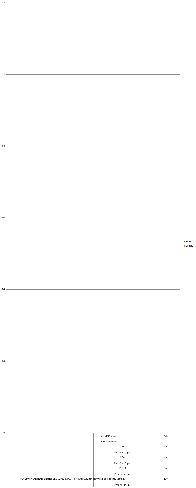
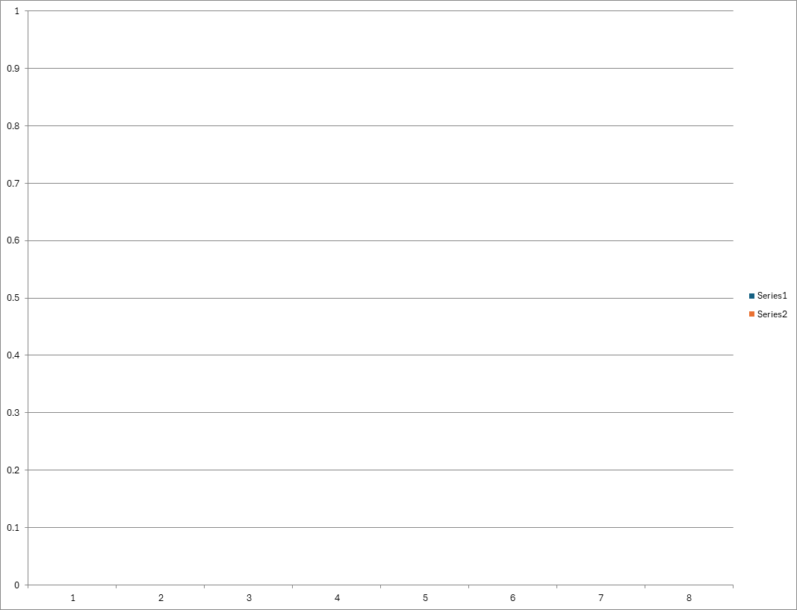
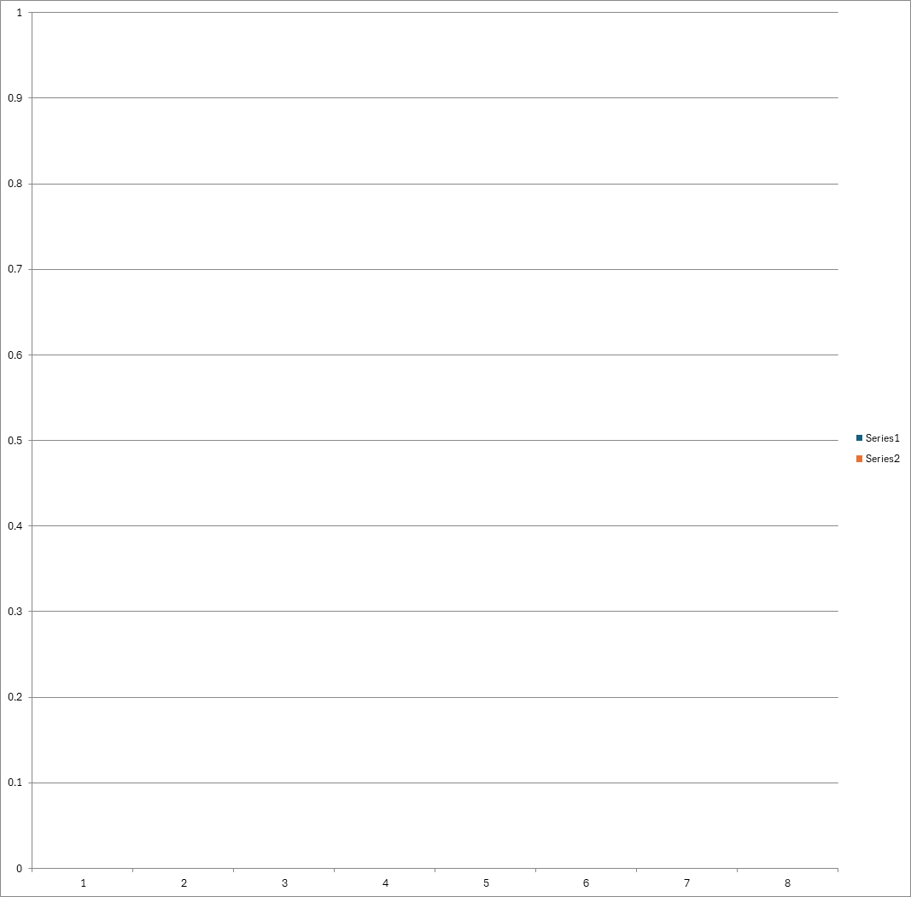
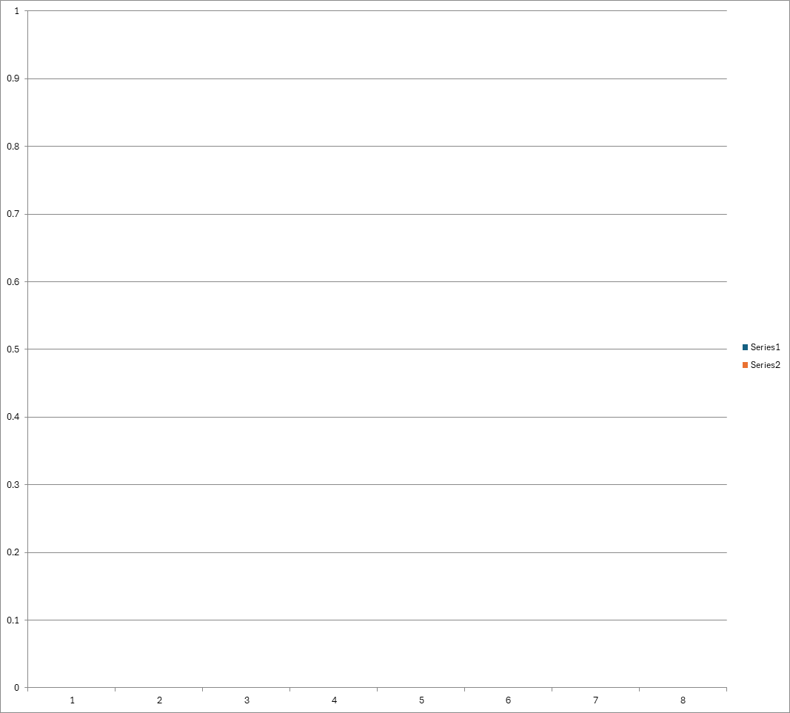
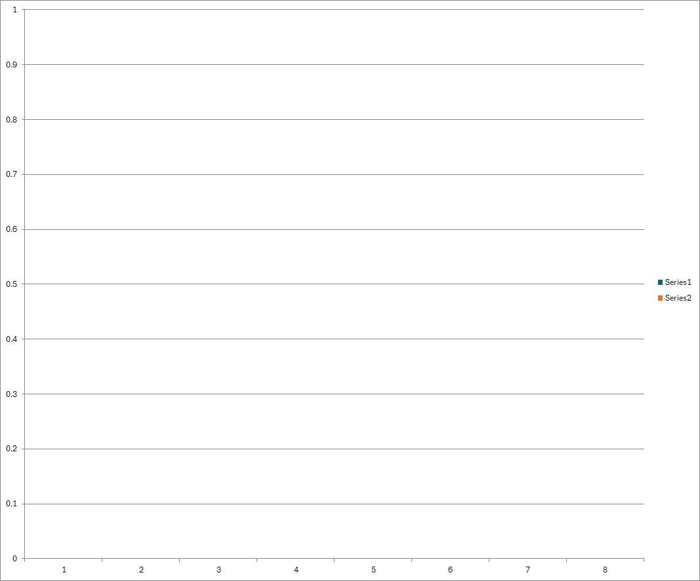
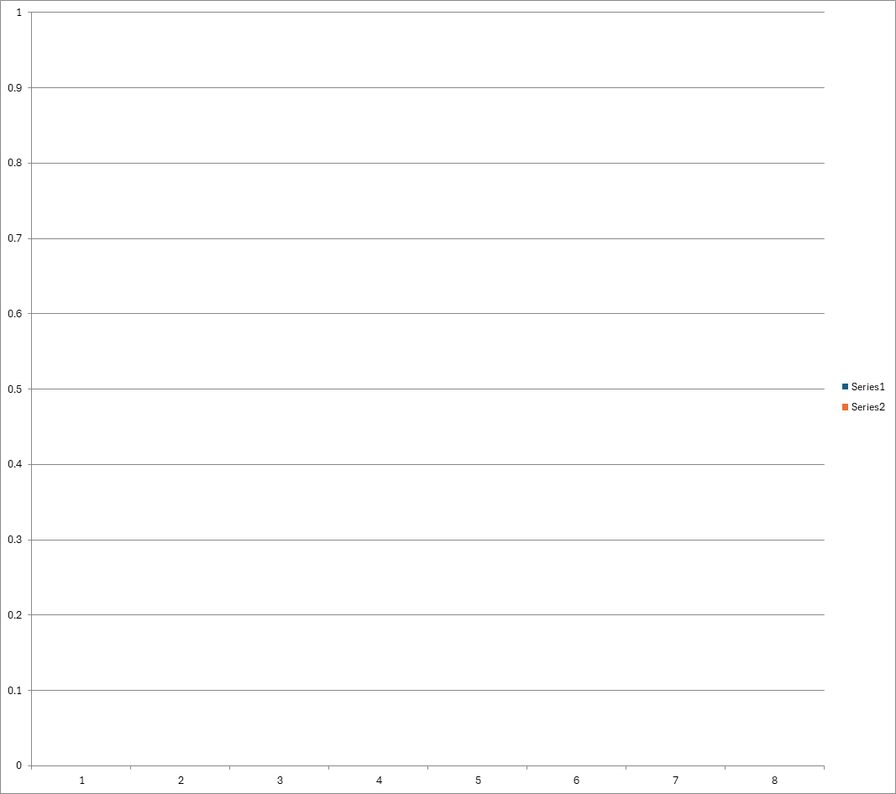
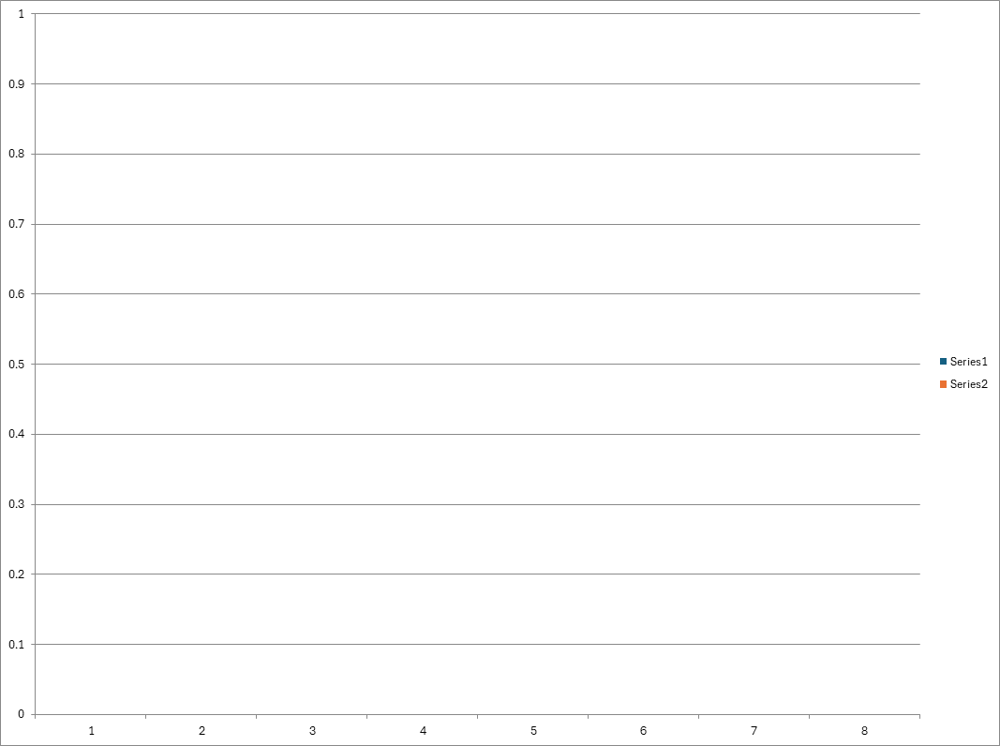
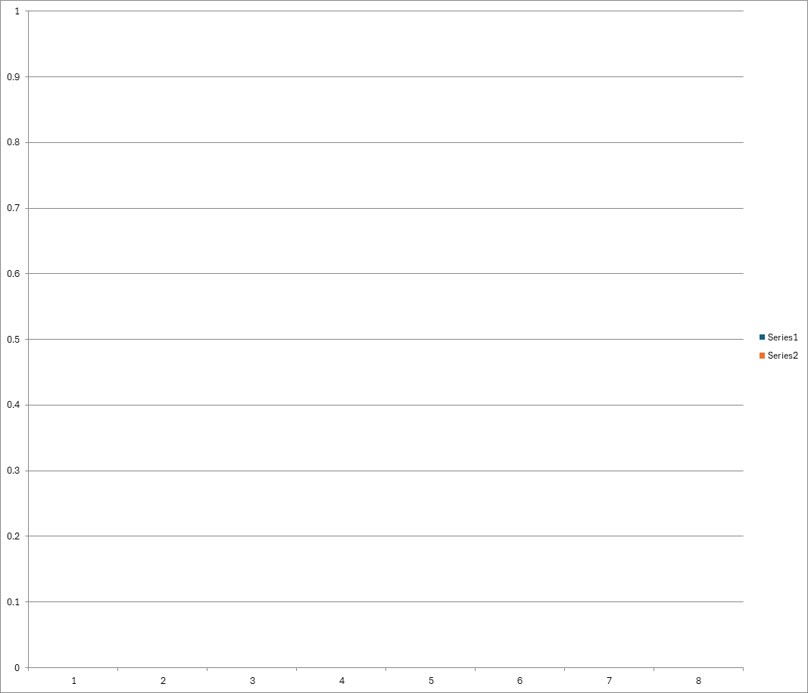
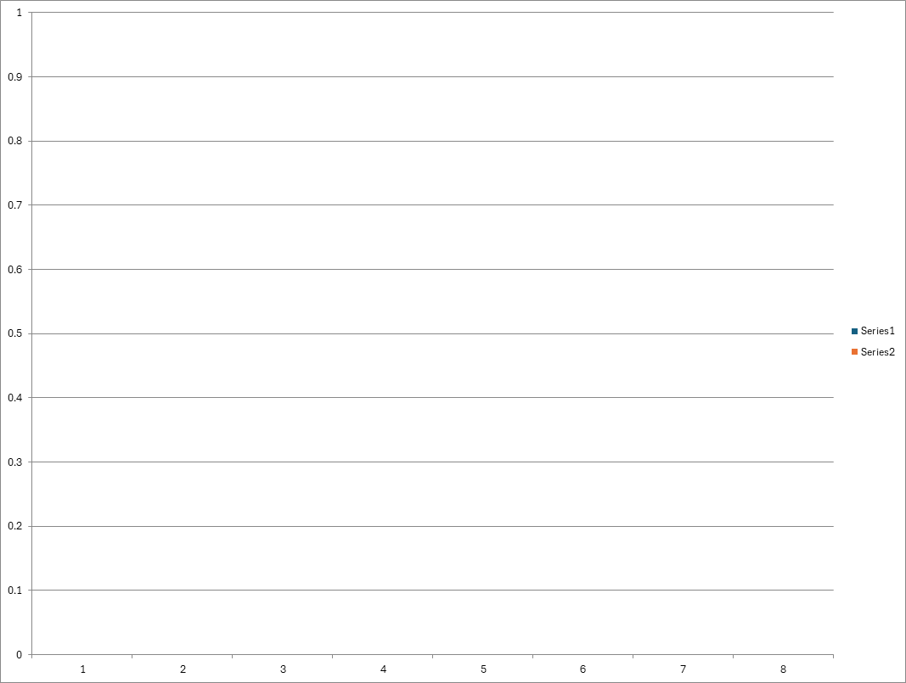
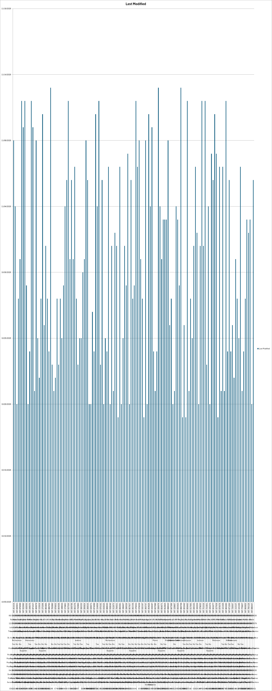

# Pending Pickup Report Builder (v1.0)

An Excel macro-enabled workbook (`.xlsm`) that turns a raw **All Open Treatment Plans** export into a
formatted **Pending Pickup** report: a KPI dashboard, one tab per Assigned Sales Manager, and the
filtered raw data. It can also compare the current run against the prior month's Pending Pickup report
to show what is new, what cleared, and what is still pending.

> Scope of this document: current behavior of the code in `Pending_Pickup_Macro.bas` and the
> embedded VBA project in `Pending Pickup Template.xlsm`. Assumed, inconsistent, or not-yet-
> implemented items are called out in **Decisions & remaining questions** and **Known issues**.

---

## 1. At a glance

| Item | Value |
| --- | --- |
| Report type | Pending Pickup worklist + KPI dashboard (DME / HME style data) |
| Inputs | Current All Open Treatment Plans export (`.xlsx`/`.xlsm`), optional prior Pending Pickup report |
| Trigger | `CREATE PENDING PICKUP REPORT` button on `START HERE` (runs `CreatePendingPickupReport`) |
| Output | New `.xlsx` with **Dashboard**, **one tab per manager**, **Raw Data** |
| Comparison key | `EMPI`, falling back to `Name` when `EMPI` is blank |
| Row filter | `Treatment Status` contains `Pending Pickup` (case-insensitive substring) |
| Source columns required | `Assigned Sales Manager`, `Treatment Status`, `Sales Representative`, `Name` |
| Config surface | Hardcoded `Const` values in the module (see Known Issues) |
| Persistence | Remembers current/prior/output folders via Windows registry `SaveSetting` |
| Code version | `1.0` — module `MACRO_VERSION = 1.0`, filenames, `START HERE`, and README all aligned |

---

## 2. Business context (confirmed)

This report is run **every month**, pulling **every patient in the country** from the All Open Treatment Plans export. It references any patient who has equipment pending pickup, and the resulting report is sent to each manager covering their team/region — so each manager sees exactly the patients they need to close out and pick up equipment for.

- **Pending Pickup is the only treatment status included.** A record leaves the report ("cleared") when the equipment is picked up and the patient is closed out, **or** when the patient is returned to active and the status is no longer Pending Pickup. Both are legitimate exits, so "in prior but not current" means cleared.
- **Pickup Age** = days from `AUDIT: TP End Date` to today. **Older is worse** — it means the account has been waiting longer for pickup.
- **Missing `AUDIT: TP End Date`** means whoever flagged the account for pickup forgot to enter the date, so the wait time is unknown; these are surfaced as `MISSING DATE`.
- **Cadence:** run monthly. Each run compares against the **prior month's generated Pending Pickup report** to show progress (cleared / still pending) plus what is new.
- **EMPI** is present in the export but is **not shown in the final report** — it is treated as noise. It is still used internally as the comparison key, with `Name` as the fallback.
- **Roles:** `Assigned Sales Manager` owns a manager tab; `Sales Representative` is the rep on the record. No rep works for more than one manager. `Assigned Associate WCC`, `Assigned Setup Technician`, and `Admin Representative` are supporting roles shown on manager tabs.

---

## 3. Project files

| File | Role |
| --- | --- |
| `Pending Pickup Template.xlsm` | Master workbook. Contains `START HERE`, empty `Raw Data`, `_Config`, and the embedded VBA project (`PendingPickupReport` module). This is what users run. |
| `Pending_Pickup_Macro.bas` | Readable VBA source for the builder. Edit this, then run `scripts\sync_template.ps1` to push it into the template. |
| `scripts\sync_template.ps1` | Maintainer script: re-imports the `.bas` into the template's embedded VBA and ensures the `START HERE` button. Run after every `.bas` change. |
| `scripts\snapshot-report.ps1` | QA script: opens a generated report `.xlsx` and exports every sheet (Dashboard, manager tabs, Raw Data) as a PNG into `documentation/screenshots/`. Run after a successful `run-report.ps1` run to refresh screenshots. |
| `documentation/screenshots/` | Committed QA PNGs captured from `Reports/Pending Pickup 2026-11-14.xlsx`: Dashboard, all manager tabs, Raw Data. |
| `AllOpenTreatmentPlansResults618.xlsx` | Raw export sample — populated with **fake data** (150 Pending Pickup + 15 other-status rows, 10 managers, mixed aging, some missing `AUDIT: TP End Date`, some blank `EMPI`). Used to test the builder. |
| `Reports/` | Output folder for finished reports. The macro's remembered `OutputFolder` is pre-set to this path. Also holds `Pending Pickup 2026-10-13.xlsx`, a **prior-month fixture** for testing comparison (still/new/cleared). |
| `documentation/changelog.md` | Dated (`YYYY-MM-DD HH:MM:SS`) change log. |

> **Distribution:** end users receive only `Pending Pickup Template.xlsm`. It is self-contained
> (macro, button, and company logo embedded); the `.bas`, `scripts\sync_template.ps1`,
> `scripts\snapshot-report.ps1`, `documentation/README.md`, `documentation/changelog.md`,
> `documentation/screenshots/`, and fake data are maintainer-only.

### Template workbook sheets

- **START HERE** — branded landing page: title + logo, a 4-step how-it-works, a styled
  `CREATE PENDING PICKUP REPORT` button (autoshape, `OnAction` = `CreatePendingPickupReport`), and a
  good-to-know panel.
- **Raw Data** — header-only table matching the export layout. Not used as input at runtime (the macro
  reads the selected export file directly); it is documentation/placeholder.
- **_Config** — a small settings table (`Pending Text`, `Key Header`, `Name Header`, `Pickup Date
  Header`, `Start Date Header`). **Not read by the current macro** — see Known Issues.

---

## 4. Requirements

- Windows + desktop Excel (uses `Application.FileDialog`, `SaveSetting`, `ThisWorkbook.FileFormat`).
- Master saved as **`.xlsm`**. If opened as `.xlsx`, `EnsureMacroEnabledWorkbook` prompts to Save As
  `.xlsm` before any work.
- Macros enabled (the workbook is macro-enabled and lives in a trusted location).

---

## 5. Setup & maintenance

**End users: no setup.** The template is ready to use. Open
`Pending Pickup Template.xlsm`, click **CREATE PENDING PICKUP REPORT** on `START HERE`, and follow
the prompts. The builder, button, and company logo are embedded in the workbook; the `.bas` is never
imported by end users.

**Maintainers: after editing `Pending_Pickup_Macro.bas`, re-sync the template.** The `.xlsm` does
**not** auto-update from the `.bas`; it carries its own compiled copy. Run:

```powershell
powershell -ExecutionPolicy Bypass -File .\scripts\sync_template.ps1
```

`sync_template.ps1` opens the template in Excel, replaces the embedded `PendingPickupReport` module with
the current `.bas`, ensures the `START HERE` button exists and points at `CreatePendingPickupReport`, and
saves. It requires desktop Excel and "Trust access to the VBA project object model" enabled
(`HKCU\Software\Microsoft\Office\16.0\Excel\Security\AccessVBOM = 1`).

**QA:** after a successful `scripts\run-report.ps1` run, refresh the committed screenshots with:

```powershell
powershell -ExecutionPolicy Bypass -File .\scripts\snapshot-report.ps1
```

This exports every sheet of `Reports/Pending Pickup yyyy-mm-dd.xlsx` as a PNG into
`documentation/screenshots/` for the README.

---

## 6. Template flow

1. Open `Pending Pickup Template.xlsm`.
2. Press the **CREATE PENDING PICKUP REPORT** macro/button on `START HERE`.
3. A window opens to select the **raw data** (the current All Open Treatment Plans export).
4. A second window asks whether to **import last month's report**. Select it to compare, or **Cancel** —
   Cancel means no comparison happens.
5. The report is generated.
6. You are asked **where to save** it. Once a save location is chosen it is remembered, and you are not
   asked again.
7. If `Pending Pickup yyyy-mm-dd.xlsx` already exists, a timestamped filename
   (`Pending Pickup yyyy-mm-dd_HHMMSS.xlsx`) is used instead of overwriting.

This project's save location is `...\Pending Pickup Project\Reports`, already set as the remembered
`OutputFolder` (registry `HKCU\Software\VB and VBA Program Settings\PendingPickupReport\Settings\OutputFolder`).
Folder memory uses `SaveSetting "PendingPickupReport", "Settings", <CurrentFolder|PriorFolder|OutputFolder>`.

**Testing comparison:** with the bundled prior fixture in `Reports/`, select
`Reports\Pending Pickup 2026-10-13.xlsx` at step 4. Expected result against the current fake export:
~114 still pending, ~36 new, ~12 cleared.

---

## 7. Data contract (current export)

The macro locates a header row (scans rows 1–25) that contains all four required headers, then reads
the used range. It looks for a sheet named `Raw Data` first, otherwise any sheet with the headers.

**Required headers**

| Header | Used for |
| --- | --- |
| `Assigned Sales Manager` | Manager tab grouping (blank → `Unassigned`) |
| `Treatment Status` | Row filter (`Pending Pickup` substring) |
| `Sales Representative` | Sort + rep banding on manager tabs |
| `Name` | Comparison fallback key; manager-tab display |

**Optional but used when present**

| Header | Used for |
| --- | --- |
| `EMPI` | Primary comparison key |
| `AUDIT: TP End Date` | Pickup Age (days) and 30/60/90 aging |
| `Start Date` | Manager-tab column + date formatting |

If a required header is missing, the macro stops with a message listing what is required.

---

## 8. Comparison logic

- A row is "pending" when `Treatment Status` contains `Pending Pickup` (case-insensitive).
- Key = `EMPI` (trimmed, case-insensitive); if blank, fall back to `Name`; if both blank, `ROW-<n>`.
- **Still Pending** = key in both current and prior.
- **New** = key in current but not prior.
- **Cleared / No Longer Pending** = key in prior but not current. Confirmed as a real exit: either the
  equipment was picked up and the patient closed out, or the patient was returned to active (status no
  longer Pending Pickup).
- With no prior report selected, `NEW`, `CLEARED`, `STILL PENDING`, `PRIOR`, and `% CHANGE` show `N/A`.

> Note: comparison is at the **record/key** level, not the row level — duplicate `EMPI`s collapse to the
> first occurrence in each report. Because `EMPI` is treated as noise in the report, rows with a blank
> `EMPI` fall back to `Name`; confirm names are unique enough for reliable matching (see Open Questions).

---

## 9. Output specification

Output workbook = new `.xlsx` containing **Dashboard**, **manager tabs**, **Raw Data**.

### 9.1 Dashboard

- Title banner (rows 1–2), with the company logo at the top-right (`I1:J2`). The logo is embedded in the
  template and copied into the generated report by `AddLogoFromTemplate`.
- **KPI cards, 5 × 2 grid:**
  - Row 1: `CURRENT`, `PRIOR`, `NEW`, `CLEARED`, `STILL PENDING`.
  - Row 2: `% CHANGE`, `30+ DAYS`, `60+ DAYS`, `90+ DAYS`, `MISSING DATE`.
- **Pending Pickups by Manager** table (header row 13, data from row 14), with columns:
  `Manager` (hyperlink to that manager's tab), `Current`, `New`, `30+ Days`, `60+ Days`, `90+ Days`,
  `Missing Date`, `Avg Age`, `% 30+`.
- `% CHANGE` = (current − prior) / prior, shown as `0.0%`; `N/A` without a prior. (Fixed: previously written as text so the number format never applied; now written as a numeric value so it renders as a true percentage.)
- `Avg Age` = mean pickup age over rows with a valid `AUDIT: TP End Date`; `% 30+` = share of the
  manager's rows older than 30 days.

### 9.2 Manager tab (one per `Assigned Sales Manager`)

- Rows 1–2: manager name banner.
- KPI cards: `PENDING PICKUPS`, `SALES REPS` (unique rep count), `NEW`, `30+ DAYS`, `60+ DAYS`,
  `90+ DAYS`, `MISSING DATE`.
- Row 10: table header. Data from row 11.
- Sorted by `Sales Representative`, then `Name`. Rows are banded by rep (alternating fill per rep
  group). New records (when a prior is selected) are bold + green fill. Pickup Age > 30 shows red text.
- Freeze panes at row 11; gridlines off; zoom 85%.
- Column order: `Sales Representative`, `Start Date`, `Name`, then remaining retained source columns,
  with calculated `Pickup Age (Days)` last.

**Excluded from manager tabs:** `EMPI`, `Customer`, `Treatment Status`, `Consumable Type`, `Assigned
Setup Technician`, `Admin Representative`, `Patient Date of Birth`, `Last Name`, `Assigned Sales
Manager`, `Assigned Associate WCC`.

### 9.3 Raw Data tab

- Current pending rows only, original column order, formatted as a filterable table with frozen header.
- Column widths/number formats copied from the source where possible.

---

## 10. Aging definition

- **Pickup Age (Days)** = `today − date(AUDIT: TP End Date)`, floored at 0 for future dates. Confirmed:
  **older is worse** (longer wait for pickup).
- **30+/60+/90+** buckets count rows with age **strictly greater than** 30 / 60 / 90 days (so exactly 30
  days is *not* counted as "30+"). See Known Issues for the boundary question.
- **Missing Date** counts pending rows with no parseable `AUDIT: TP End Date` — confirmed to mean the
  user who flagged the account forgot to enter the pickup date, so the wait is unknown. Also counts all
  rows as missing if the column is absent.

Date parsing accepts real Excel dates, Excel serial numbers, and text dates.

---

## 11. Screenshots

QA screenshots of the generated report (Dashboard KPI cards, manager tabs, Raw Data) are stored in `documentation/screenshots/`. These were captured from `Reports/Pending Pickup 2026-11-14.xlsx` after a clean end-to-end run (no errors in `macro-debug.log`, completion marker written).

### Dashboard



### Manager tabs

Each `Assigned Sales Manager` gets its own tab with KPI cards, a rep-banded data table, freeze panes at the header row, and calculated Pickup Age.












### Raw Data

Filtered pending rows with frozen header and date formats.



---

## 12. Known issues / technical debt

1. **Embedded VBA vs `.bas` source.** The `.xlsm` embeds its own compiled copy; editing the `.bas` does
   **not** update the template. After every `.bas` change, run `sync_template.ps1` (Excel + `AccessVBOM=1`)
   to re-import the module. End users never import anything.
2. **Vestigial `_Config` sheet.** All labels are hardcoded `Const` values; the macro never reads
   `_Config`. Either wire the macro to `_Config` or remove the sheet.
3. **Redundant `Raw Data` sheet in the master.** It is not consumed as input; it can drift from the real
   export. Consider removing or clearly marking it as a schema reference.
4. **Aging boundary.** KPI labels say "30+ / 60+ / 90+ days" but the code uses `> 30 / > 60 / > 90`.
   Decide whether the boundary should be inclusive.
5. **`SetupPendingPickupButton` is `Private`.** It cannot be run from the standard Macro dialog; the
   README/setup must explain the editor-based run, or it should be made `Public` for one-time setup.
6. **Duplicate `EMPI`/missing keys.** Comparison silently collapses duplicates and invents `ROW-<n>`
   keys; mismatches in source keys can produce misleading new/cleared counts.
7. **Performance.** Manager row sorting and rep banding are cell-by-cell; large exports may be slow.
   Consider array-based sorting and bulk formatting.
8. **No automated tests.** The builder can be exercised manually with the bundled fake export
   (`AllOpenTreatmentPlansResults618.xlsx`) and prior fixture (`Reports/Pending Pickup 2026-10-13.xlsx`),
   but there is no automated regression test.

---

## 13. Decisions & remaining questions

**Confirmed with the business owner**

- Filter status is **Pending Pickup** only.
- **Older = worse**: Pickup Age is days waiting, measured from `AUDIT: TP End Date` to today.
- **Cleared is legitimate**: a record drops when equipment is picked up/closed out, or when the patient
  is returned to active.
- **Comparison baseline**: the **prior month's generated Pending Pickup report**, run monthly.
- **Scale/shape for test data**: 10 managers, varied reps per manager, no rep on more than one manager,
  ~100–200 pending samples, realistic aging mix.
- **`EMPI` is noise** in the final report (not displayed); `MISSING DATE` = forgotten pickup date.

**Still open**

1. **Comparison key policy.** Since `EMPI` is "noise", should the builder keep using it internally
   (falling back to `Name`), or match on `Name` only? Blank `EMPI` is already handled, but name collisions
   would then cause wrong new/cleared counts.
2. **EMPI in Raw Data.** `EMPI` is excluded from manager tabs but still appears on the **Raw Data** tab.
   Remove it there too, or keep it as the backing key?
3. **Non-pending rows in the export.** Real "All Open Treatment Plans" exports contain other statuses;
   the macro filters them out. Confirm we should keep a realistic status mix (not all Pending Pickup) in
   the source so the filter is exercised.
4. **Consumers/decision.** Who reads the dashboard and manager tabs, and what action does it drive
   (daily huddle, monthly review, 30/60/90+ escalation)?
5. **Edge-case policy.** Confirm the current defaults: blank manager → `Unassigned`, missing
   `EMPI`+`Name` → synthetic `ROW-<n>` key, future pickup date → age 0.
6. **Aging boundary.** Keep strict `> 30 / > 60 / > 90`, or make the labels truly inclusive (`>=`)?
7. **Future scope.** Any additions — trend charts, email/export, scheduled refresh, multi-site, or extra
   KPIs?

---

## 14. Changelog

See [`documentation/changelog.md`](changelog.md) for the dated (`YYYY-MM-DD HH:MM:SS`) change log. Version `1.0` is the
current baseline; the older per-version history that used to live in the module header has been retired
in favor of the changelog file.